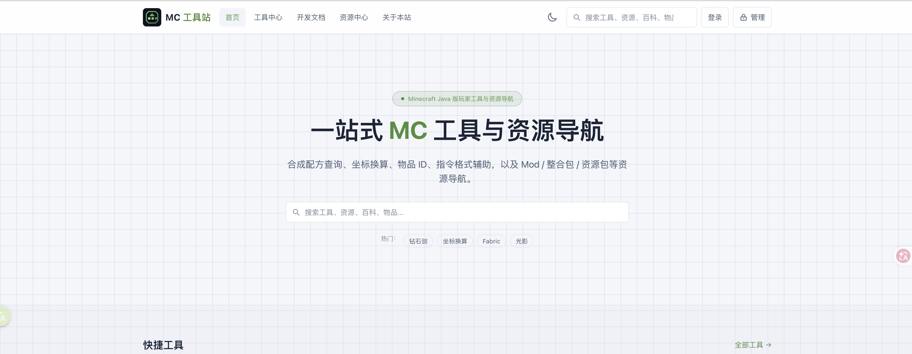
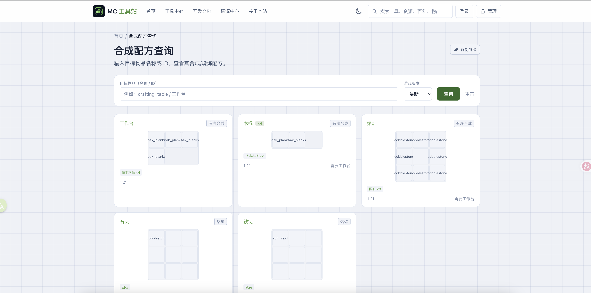
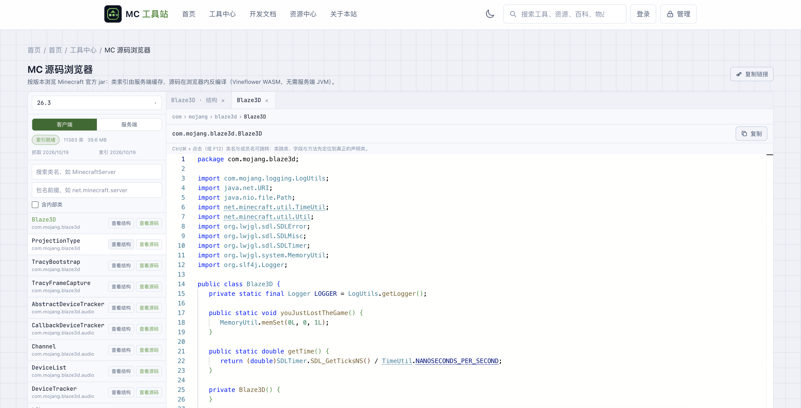
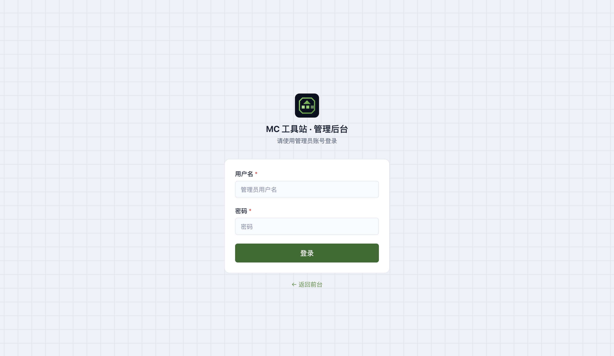
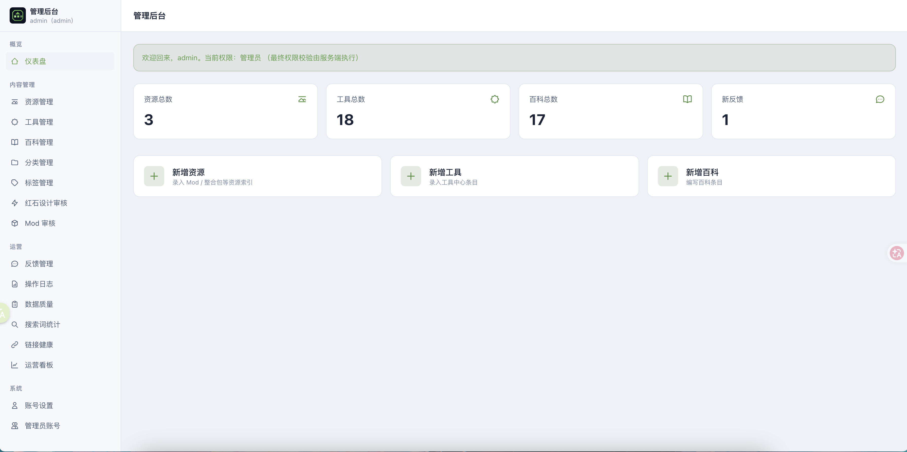
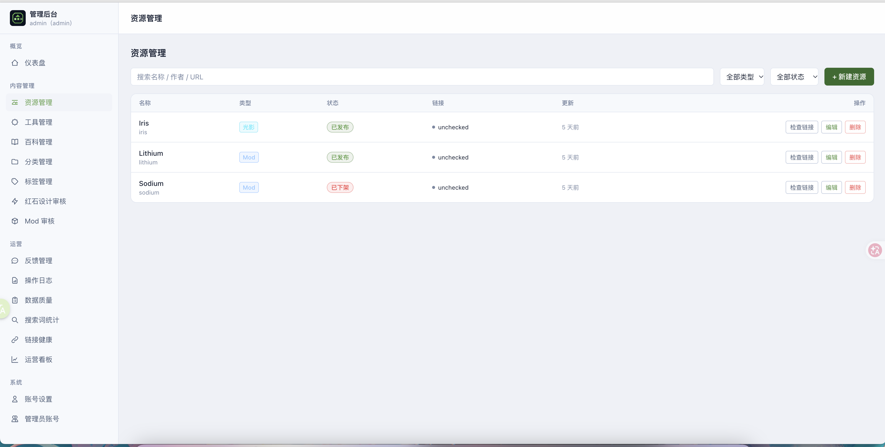
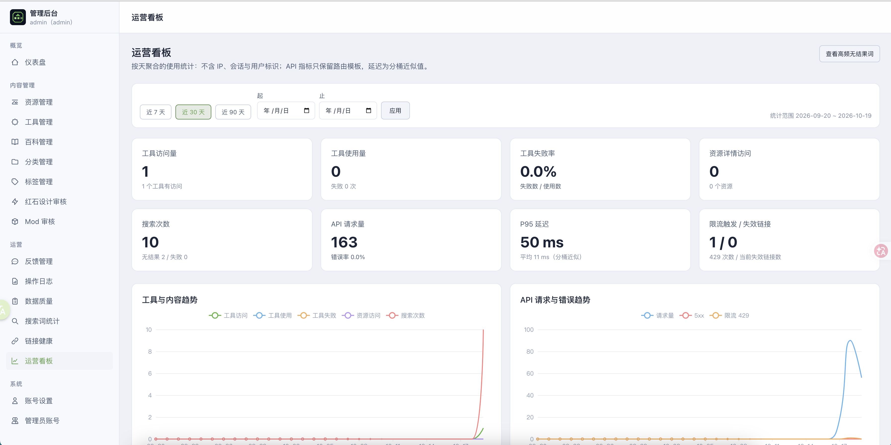
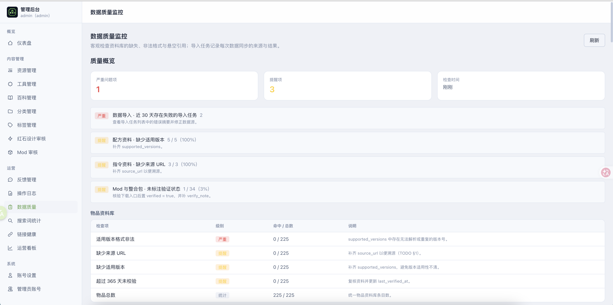
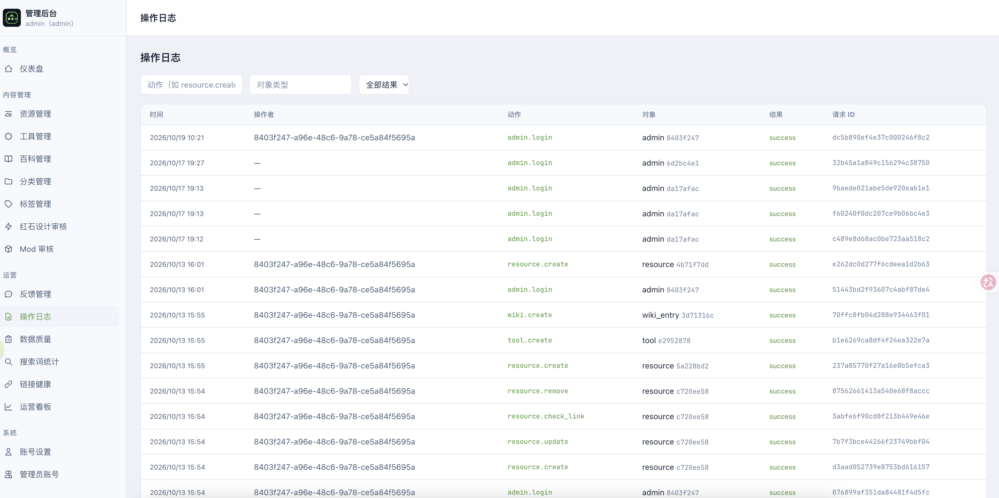

# MC 工具站（mckit）

面向 Minecraft Java 版玩家、整合包玩家、服务器管理者和 Mod 开发者的**工具与资源导航站**。非官方社区项目，不暗示 Mojang 或 Microsoft 背书。

技术栈：Go 1.27 + Chi + GORM + PostgreSQL 16 · Vue 3 + TypeScript + Vite



## 功能概览

- **资料查询**：物品 ID 对照、合成配方、药水与酿造、村民交易、生物资料（掉落 / 生成 / 驯服繁殖）、红石元件与机器设计、Mod 与整合包（依赖 / 冲突**仅呈现已记录项**，不做自动冲突分析）。
- **内置工具**：指令格式辅助、可视化指令生成器、附魔与装备计算器、坐标换算、MC 版本清单、种子地图与种子工具、区块与存档检查。
- **开发栏目**：开发文档知识库（NeoForge / Forge / Fabric / 原版数据，含关键接口速查）与**版本映射查询**（类 / 方法 / 字段的 obf / mid / named 三列对照；映射数据需自行导入，仓库不预置）。
- **百科与资源**：中文 Wiki 条目抓取与浏览；资源导航（类型 / 版本 / 加载器筛选、来源跳转、失效链接检查）。
- **全站搜索**：跨 **工具 / 资源 / 百科 / 物品 / 开发文档** 统一检索，支持类型与版本筛选、相关度 / 最近更新排序与无结果引导。
- **用户与后台**：可选账号（收藏 / 最近使用 / 常用种子；公开工具免登录）；每个账号拥有随机生成的对外用户 ID（形如 `U7K3M2QX9F`，内部主键仍为 UUID）；**用户资源投稿**（结构化提交 → 人工审核 → 审核通过转为资源）；管理后台含内容 CRUD、投稿审核（红石 / Mod / 资源投稿 / 反馈）、链接健康复查、数据质量与导入历史、运营看板、审计日志。
- **用户成长**：服务端判定的经验 / 等级（仅展示）/ 每日任务 / 成就体系；由已确认的业务事件驱动，经验账本只增不删、支持审计与人工冲正；后台可版本化维护规则与定义、按内部 UUID 或对外用户 ID 调整单用户等级偏移、手动授予 / 撤销成就，并按 `ops.growth` 权限管理。等级定义可编辑和重算，也可新增（追加到最高级之后）或删除最高级；Lv.1 固定保留，删除后会自动重算用户展示等级。后台「用户详情」可按用户树状展开等级进度、成就解锁时间、经验流水、礼物币收支与成长审计日志。
- **礼物中心**：每日签到领取「签到礼物币」；礼物币分为**通用 / 签到**两类余额，后台按 `ops.gifts` 权限受控增减（支持内部 UUID / 对外用户 ID），任一余额不得为负，每次变动写入不可删除的账本并记录操作人。后台可维护礼物目录（名称、图标、价格、是否允许签到币兑换、排序、启停）与每日签到奖励，并在同一「礼物」页查看签到 / 礼物 / 礼物币排行榜；用户用礼物币兑换礼物并查看兑换记录与流水；已有兑换记录的礼物只能停用、不能删除。
- **玩家社区**：帖子 / 留言 / 点赞与分类筛选；公开读免登录，发帖 / 留言 / 点赞要求普通用户会话并走 CSRF；作者可用对外用户 ID 署名；后台按 `content.community` 权限隐藏 / 恢复 / 删除内容，并在「用户评论」中跨帖子检索全部评论。内容健康模块支持维护屏蔽关键字，发帖 / 评论命中启用规则时由服务端直接拒绝。

## 界面预览

| 前台功能 | MC 源码浏览器 |
|---|---|
|  |  |

| 后台登录 | 后台总览 |
|---|---|
|  |  |

| 后台内容管理 | 运营看板 |
|---|---|
|  |  |

| 数据质量检查 | 操作日志 |
|---|---|
|  |  |

## 目录结构

```text
.
├── backend/               # Go 后端
│   ├── cmd/
│   │   ├── api/           # API 服务
│   │   ├── migrate/       # 数据库迁移
│   │   ├── seed/          # 数据导入
│   │   ├── import-mappings/ # 映射文件导入（ProGuard / TSRG·TSRG2 / Tiny v1·v2）
│   │   ├── wikicrawl/     # 百科抓取（可选）
│   │   └── create-admin/  # 初始化管理员
│   ├── internal/          # 业务代码（config/http/domain/service/auth/search/linkcheck/audit/mappings）
│   ├── migrations/        # SQL 迁移文件
│   ├── seeds/             # 演示数据
│   ├── openapi/           # OpenAPI 3 接口规范
│   └── Dockerfile
├── frontend/              # Vue 3 前端
├── deploy/                # Docker Compose + Caddy
├── scripts/               # dev.sh / backup.sh / restore.sh
├── images/                # README 界面截图
├── .env.example
└── README.md
```

## 快速开始（开发环境）

### 前置要求

- Go ≥ 1.27
- Node ≥ 20、npm ≥ 10
- Docker + Docker Compose（PostgreSQL 16）

### 步骤

```bash
# 1. 生成 .env 并启动 PostgreSQL
cp .env.example .env
# 编辑 .env，至少修改 SESSION_SECRET 为强随机值
openssl rand -hex 32   # 生成 SESSION_SECRET

docker compose -f deploy/compose.yaml up -d postgres

# 2.（可选）手动执行数据库迁移
#    API 启动时会默认自动应用未执行的迁移（AUTO_MIGRATE=true）；
#    手动执行便于提前发现失败，或在不启动服务时完成变更。
cd backend && go run ./cmd/migrate

# 2b. 迁移回滚（可选）
#     反向文件命名约定：<序号>_<名称>.sql 为正向，<序号>_<名称>.down.sql 为反向
go run ./cmd/migrate --down 1          # 回退最近 1 个版本
go run ./cmd/migrate --down 3          # 回退最近 3 个版本（按版本降序，逐版本单事务）
go run ./cmd/migrate --to 20           # 前进 / 回退到指定版本（自动判断方向）
go run ./cmd/migrate --dir migrations  # 显式指定迁移目录（默认 migrations）
#     --to 与 --down 互斥；缺少反向文件时明确报错停止，不会静默跳过

# 3. 初始化管理员（无默认密码，必须提供强密码）
ADMIN_USERNAME=admin ADMIN_PASSWORD='你的强密码' go run ./cmd/create-admin

# 4. 启动后端（:8080）
go run ./cmd/api

# 5. 启动前端（:5173，热更新）
cd ../frontend && npm install && npm run dev
```

浏览器访问 http://localhost:5173 ，API 基础地址 http://localhost:8080/api/v1 。

> 另可一键执行 `./scripts/dev.sh`（自动建 .env、起库、迁移）。

## 导入演示数据

```bash
cd backend
# dry-run 预检查
go run ./cmd/seed --type items --file seeds/items_demo.json --dry-run
# 正式导入
go run ./cmd/seed --type items --file seeds/items_demo.json
go run ./cmd/seed --type recipes --file seeds/recipes_demo.json
go run ./cmd/seed --type commands --file seeds/commands_demo.json
# 资源（含发布版本，TODO §6）
go run ./cmd/seed --type resources --file seeds/resources_demo.json
# 进阶资料：药水与酿造 / 村民交易 / 生物资料 / 开发文档 / 红石资料 / Mod 兼容性
go run ./cmd/seed --type potions --file seeds/potions_demo.json
go run ./cmd/seed --type villagers --file seeds/villagers_demo.json
go run ./cmd/seed --type mobs --file seeds/mobs_demo.json
go run ./cmd/seed --type devdocs --file seeds/dev_docs_demo.json
go run ./cmd/seed --type redstone --file seeds/redstone_demo.json
go run ./cmd/seed --type mods --file seeds/mods_demo.json
# 统一入口：以 seeds 目录批量导入（按依赖顺序：items → potions → villagers → mobs
#   → redstone → mods → devdocs → recipes → commands → tools → resources）
go run ./cmd/seed --type all --file seeds
```

可用类型：`items` / `recipes` / `commands` / `tools` / `resources` / `potions` / `villagers` /
`mobs` / `devdocs` / `redstone` / `mods` / `all`。各类型的字段与校验规则见 `cmd/seed` 与 `seeds/` 下对应数据文件。

导入器按业务主键（item_id / recipe_key / slug）幂等更新，重复运行不产生重复记录；
每行数据会做必填、枚举、数值与版本格式（含 `1.16-1.17`、`1.18+` 范围，以及 `all` 全版本通配）校验，
失败逐行汇总；每次执行写入 `data_import_jobs`，可在后台 `审核与运营 → 内容健康 → 数据质量`（admin）
查看导入历史与数据质量概览。

资源导入额外校验**加载器枚举、依赖结构（`type ∈ dependency·prerequisite·conflict`）与发布版本结构**；
`releases` 字段缺省表示「不触碰已有发布版本」，显式空数组表示「清空」。

资源、搜索与配方页的**版本筛选项动态取自官方版本清单**（`POST /api/v1/versions`，服务端带缓存）；
拉取失败时回退内置兜底清单，保证筛选始终可用。声明 `all` 表示适用于全部 MC 版本（必须独占），
详情页可展开完整正式版清单。

后台 `审核与运营 → 运营分析 → 搜索词统计`（admin）可查看热门搜索、高频无结果词与查询失败词——
统计为**匿名化聚合**（仅关键词与计数，不含 IP / 会话 / 用户标识）。

## 抓取百科内容（可选）

从中文 Minecraft Wiki 抓取公开条目，转换为 Markdown 存入 `wiki_entries`。
内容授权 CC BY-NC-SA 3.0，遵守 robots.txt 并限速；每条记录保留来源 URL 与许可信息。

```bash
cd backend
# 预检查（只抓取打印，不写库）
go run ./cmd/wikicrawl --titles "交易,附魔,合成" --dry-run
# 按清单批量抓取（清单见 seeds/wiki_crawl_titles.txt）
go run ./cmd/wikicrawl --titles-file seeds/wiki_crawl_titles.txt
```

- 自动处理重定向（如 `酿造 → 药水酿造`、`结构 → 生成结构`），并以重定向后的真实标题生成 slug。
- 正文解析为 Markdown（标题、段落、列表、表格、链接），过滤目录/导航框/图片说明/编辑链接等噪音。
- 仅抓取 `/w/` 普通条目；不使用被 robots.txt 禁止的 `api.php` / `rest_v1`；请求间隔默认 1 秒，失败线性退避重试。
- 参数：`--titles`、`--titles-file`、`--dry-run`、`--interval`、`--content-type`、`--game-edition`、`--user-agent`。

## 运行测试

```bash
# 后端
cd backend
go test ./...        # 单元 + 集成测试
go vet ./...         # 静态检查

# 前端
cd frontend
npm run typecheck    # vue-tsc 类型检查
npm run test         # Vitest 单元测试
npm run build        # 类型检查 + 生产构建
```

## API 说明

### 方法约定（项目决策）

- **所有查询、搜索、列表接口统一使用 `POST`**，参数放在 JSON 请求体。
- 例外：`robots.txt` / `sitemap.xml` 保持 `GET`（搜索引擎协议要求），健康检查为 `POST`。
- 统一响应：成功 `{"data": ..., "meta": ...}`，错误 `{"error": {...}, "request_id": ...}`。
- 分页：`page` 从 1 开始，`page_size` 默认 20、最大 50。

### 主要端点

| 方法 | 路径 | 说明 |
|---|---|---|
| POST | `/api/v1/health` | 健康检查 |
| POST | `/api/v1/search` | 全站搜索（`q`、`type`、`game_version`、`sort`、`page`、`page_size`；`type` 取 `tool` / `resource` / `wiki` / `item` / `devdoc`；无结果时 `meta.suggestions` 给出可尝试关键词） |
| POST | `/api/v1/tools`、`/api/v1/tools/:slug` | 工具列表 / 详情 |
| POST | `/api/v1/resources`、`/api/v1/resources/:slug` | 资源列表 / 详情（详情含发布版本与兼容性结论，无数据依据时返回「未验证」；声明 `all` 时 `all_versions=true`） |
| POST | `/api/v1/items`、`/api/v1/items/:item_id` | 物品查询 / 详情（item_id 含冒号） |
| POST | `/api/v1/recipes` | 配方查询（`item_id`、`game_version`、`recipe_type`；每项附 `resolved_items` 关联物品） |
| POST | `/api/v1/commands`、`/api/v1/commands/:slug` | 指令列表 / 详情 |
| POST | `/api/v1/wiki/:slug` | 百科详情 |
| POST | `/api/v1/potions`、`/api/v1/potions/rules`、`/api/v1/potions/:slug` | 药水与酿造（列表 / 通用酿造规则 / 详情） |
| POST | `/api/v1/villagers`、`/api/v1/villagers/levels`、`/api/v1/villagers/:slug` | 村民交易（列表 / 交易等级 / 详情） |
| POST | `/api/v1/mobs`、`/api/v1/mobs/:slug` | 生物资料（列表 / 详情） |
| POST | `/api/v1/redstone/components`、`/api/v1/redstone/components/:slug` | 红石元件（列表 / 详情） |
| POST | `/api/v1/redstone/designs`、`/api/v1/redstone/designs/:slug` | 红石机器设计（列表 / 详情） |
| POST | `/api/v1/mods`、`/api/v1/mods/:slug` | Mod（列表 / 详情；依赖与冲突仅呈现已记录项） |
| POST | `/api/v1/modpacks`、`/api/v1/modpacks/:slug` | 整合包（列表 / 详情） |
| POST | `/api/v1/dev-docs`、`/api/v1/dev-docs/facets`、`/api/v1/dev-docs/:slug` | 开发文档知识库（列表 / 平台与主题统计 / 详情） |
| POST | `/api/v1/mappings/sets`、`/api/v1/mappings/search`、`/api/v1/mappings/class/:id` | 版本映射与类 / 方法查询（需先用 `cmd/import-mappings` 导入映射数据） |
| POST | `/api/v1/versions`、`/api/v1/versions/detail` | MC 版本清单 / 版本详情（筛选下拉，服务端缓存） |
| POST | `/api/v1/block-ids` | 物品 ID 对照表 |
| POST | `/api/v1/seed/analyze`、`/api/v1/mc/*` | MC 种子与结构工具（种子分析 / 生成 / 查找 / 解析、结构、要塞、史莱姆区块、群系、能力探测） |
| POST | `/api/v1/stats/event` | 匿名使用统计上报（工具访问 / 使用 / 失败；登录用户的「使用」同时驱动成长事件） |
| POST | `/api/v1/growth/overview`、`/api/v1/growth/ledger`、`/api/v1/growth/daily-tasks`、`/api/v1/growth/daily-tasks/history`、`/api/v1/growth/achievements` | 用户成长中心（仅本人：经验概览 / 经验流水 / 每日任务 / 任务历史 / 成就目录；等级仅展示用） |
| POST | `/api/v1/public/users/detail`、`/api/v1/public/users/achievements` | 公开个人主页成长摘要与公开成就（不含经验流水与登录信息） |
| POST | `/api/v1/admin/growth/*` | 成长后台（需 `ops.growth`）：概览 / 用户详情（等级、成就、经验、礼物、审计聚合）/ 规则版本化维护 / 等级阈值与单用户等级调整 / 全局流水 / 人工调整与冲正 / 成长审计 |
| POST | `/api/v1/admin/achievements/user/list`、`/grant`、`/revoke` | 单用户成就查询 / 手动授予 / 撤销（需 `ops.growth`；撤销为软删除，不回收已发经验） |
| POST | `/api/v1/gifts/overview`、`/api/v1/gifts/ledger/list`、`/api/v1/gifts/catalog`、`/api/v1/gifts/checkin`、`/api/v1/gifts/redeem`、`/api/v1/gifts/redemptions/list` | 礼物中心（本人）：双币余额 / 流水 / 礼物目录 / 每日签到 / 兑换 / 兑换记录（写操作需 CSRF） |
| POST | `/api/v1/admin/gifts/wallet/get`、`/wallet/adjust`、`/ledger/list` | 礼物币钱包查询 / 按币种受控增减 / 流水（需 `ops.gifts`；扣减不得使余额为负） |
| POST | `/api/v1/admin/gifts/definitions/list`、`/create`、`/update`、`/delete`、`/settings/get`、`/settings/update`、`/rankings/checkin`、`/rankings/gifts`、`/rankings/coins` | 礼品目录、签到奖励与运营排行榜（需 `ops.gifts`；编码不可变，已兑换礼物只能停用） |
| POST | `/api/v1/admin/daily-tasks/*`、`/api/v1/admin/achievements/*` | 每日任务与成就定义维护（含历史补算），需 `ops.growth` |
| POST | `/api/v1/categories` | 分类列表 |
| POST | `/api/v1/feedback` | 提交反馈/举报 |
| POST | `/api/v1/user/submissions/submit`、`/api/v1/user/submissions/list` | 资源投稿（结构化提交 + 我的投稿，需登录 + CSRF） |
| POST | `/api/v1/community/posts`、`/api/v1/community/posts/detail`、`/api/v1/community/comments` | 玩家社区公开读（帖子列表 / 详情 / 留言；仅返回已发布内容，登录后附带 `liked`） |
| POST | `/api/v1/community/posts/create`、`/posts/delete`、`/posts/like`、`/comments/create`、`/comments/delete` | 社区写操作（需登录 + CSRF；普通用户与后台账号均可用，删除仅作者或帖子作者） |
| POST | `/api/v1/admin/community/posts/list`、`/posts/status`、`/posts/delete`、`/comments/list`、`/comments/all`、`/comments/status`、`/comments/delete` | 社区审核（需 `content.community`；可查看隐藏内容并隐藏 / 恢复 / 删除；`comments/all` 跨帖子检索用户评论） |
| POST | `/api/v1/admin/content-health/keywords/list`、`/create`、`/update`、`/delete` | 内容关键字屏蔽维护（需 `ops.dataquality`；社区帖子 / 评论创建时实时匹配） |
| POST | `/api/v1/admin/auth/login` `logout` `me` `change-password` | 认证（change-password 成功后该账号全部会话失效） |
| POST | `/api/v1/admin/accounts/list|create|detail|update|reset-password|delete-preview|delete|export` | 统一账号管理（普通用户与后台账号同一列表；`accounts.admins` / `accounts.users` 按目标账号角色二次校验） |
| POST | `/api/v1/admin/accounts/mfa/reset` | 解绑指定后台账号 MFA（需 `accounts.admins`） |
| POST | `/api/v1/admin/sessions/list`、`/api/v1/admin/sessions/revoke` | 全站会话管理（需 `ops.sessions`；列表仅返回展示指纹，踢下线写审计） |
| POST | `/api/v1/admin/admins/list|create|update|reset-password|delete` | 旧管理员账号接口（保留兼容，需 `accounts.admins`） |
| POST | `/api/v1/admin/users/*` | 旧普通用户接口（保留兼容，需 `accounts.users`） |
| POST/PATCH/DELETE | `/api/v1/admin/resources|tools|wiki|...` | 后台 CRUD（需登录 + CSRF） |
| POST | `/api/v1/admin/resources/releases/list`、`/api/v1/admin/resources/releases/replace` | 资源发布版本维护（需登录 + CSRF，整体替换幂等） |
| POST | `/api/v1/admin/submissions/list`、`/detail`、`/review` | 资源投稿审核（`content.resources`）：通过按投稿字段生成资源（默认草稿，可 `publish=true` 直接发布） |
| POST | `/api/v1/admin/audit-logs` | 审计日志（admin 专属） |
| POST | `/api/v1/admin/data-quality/overview`、`/api/v1/admin/data-import-jobs/list` | 数据质量概览 / 导入任务（admin 专属） |
| POST | `/api/v1/admin/search-terms/list` | 搜索词匿名统计（admin 专属；`kind=hot\|no_result\|failed`） |
| GET | `/robots.txt` `/sitemap.xml` | SEO |

完整规范见 `backend/openapi/openapi.yaml`（OpenAPI 3 描述）。

## 部署（Docker Compose）

```bash
# 生产环境变量（务必修改所有敏感项）
cp .env.example .env
# SESSION_SECRET 用强随机值；SESSION_SECURE_COOKIE=true；DATABASE_URL 指向 compose 内服务

# 构建并启动（前端、后端、Caddy、PostgreSQL）
# 后端启动时默认自动应用未执行的迁移；如需在发布前显式检查，可执行下方 migrate
docker compose -f deploy/compose.yaml --env-file .env up --build -d

# （可选）显式执行迁移，便于在服务启动前确认变更结果
docker compose -f deploy/compose.yaml exec backend /usr/local/bin/migrate

# 初始化管理员
docker compose -f deploy/compose.yaml exec -e ADMIN_USERNAME=admin -e ADMIN_PASSWORD=xxx backend /usr/local/bin/create-admin
```

Caddy 自动申请 HTTPS 证书（生产环境将 `deploy/Caddyfile` 的 `:80` 替换为域名）。

## 备份与恢复

```bash
# 备份（每日 cron 建议）
./scripts/backup.sh

# 恢复
./scripts/restore.sh <备份文件>
```

备份文件加密并限制访问；定期做恢复演练。

## 安全说明

- 密码 Argon2id 加盐哈希存储；登录失败限流（5 次/15 分钟，IP 隔离）。
- 后台账号管理基于权限点：`accounts.admins` 管理后台账号并分配角色，`accounts.users` 管理普通用户；内置 `admin` 角色拥有全部权限点。普通用户可被提升为后台角色，提升后必须修改密码才能进入后台。
- 前台登录仅接受普通用户；后台账号必须走 `/admin/auth/login`（含 MFA），避免绕过后台二次验证。
- 改密、停用、改角色、重置密码、删除后，该账号所有会话立即失效；后台账号不可自助注销。
- 系统管理提供全站会话管理（`ops.sessions`）：可查看普通用户与管理员的有效会话并按指纹踢下线，列表不回显 SessionID 原文，当前会话禁止自踢，操作写审计。
- Cookie 会话 HttpOnly + SameSite；生产强制 Secure。
- 写操作 CSRF 双重提交校验。
- 链接检查内置 SSRF 防护（拒绝内网/回环/云元数据，重定向逐跳校验）。
- 全部输入后端校验，SQL 参数化；Markdown 渲染禁用原始 HTML。
- 审计日志不记录密码、Cookie、Authorization 头、数据库连接串。

## 故障排查

| 现象 | 检查 |
|---|---|
| 启动报 `缺少必需配置 DATABASE_URL` | 是否已 `cp .env.example .env` 并 source；migrate 需在 backend 目录运行 |
| 数据库连接失败 | `docker compose -f deploy/compose.yaml ps` 确认 postgres 健康 |
| 登录 401 | 确认 `create-admin` 已执行且密码 ≥12 位 |
| CSRF 403 | 前端无 `X-CSRF-Token` 头，或 token 与会话不符 |
| 前端访问接口 405 | 确认使用 POST（全站查询为 POST） |
| 迁移文件改动不生效 | 迁移按版本号记录；新改动要新增序号文件，勿改已应用的 |
| 启动报 `数据库自动迁移失败` | 检查数据库账号是否有 DDL 权限、`MIGRATIONS_DIR` 是否指向正确的迁移目录 |
| 启动报 `未找到迁移目录` | 在 `backend` 目录启动，或通过 `MIGRATIONS_DIR` 指定绝对路径 |
| 不需要启动时自动迁移 | 设置 `AUTO_MIGRATE=false`，改为发布流程中显式执行 `cmd/migrate` |

## 决策记录

1. 查询接口全站 POST（用户确认）；SEO robots/sitemap 例外保持 GET。
2. ORM 使用 GORM，数据库迁移仍用 SQL 文件（可回滚），不使用纯 AutoMigrate；API 启动时自动执行待应用 SQL 迁移（`AUTO_MIGRATE=false` 可关闭）。
3. 会话 MVP 用内存存储（单实例）；多实例部署需替换共享会话存储。
4. 演示数据为自建整理（数据版本 demo-2026-01），来源标注在数据文件内。

## 版本记录

- v0.2.0：进阶资料（药水与酿造 / 村民交易 / 生物资料 / 红石与机器设计 / Mod 与整合包）、开发栏目（开发文档知识库 + 版本映射查询）、用户可选账号与工作台、使用统计与运营看板、投稿与纠错、链接健康检查、分享与易用性；**开发文档接入全站搜索**（`type=devdoc`）。
- v0.1.0：工程骨架、认证、后台 CRUD、公开 API、搜索、数据导入、SEO、部署配置。